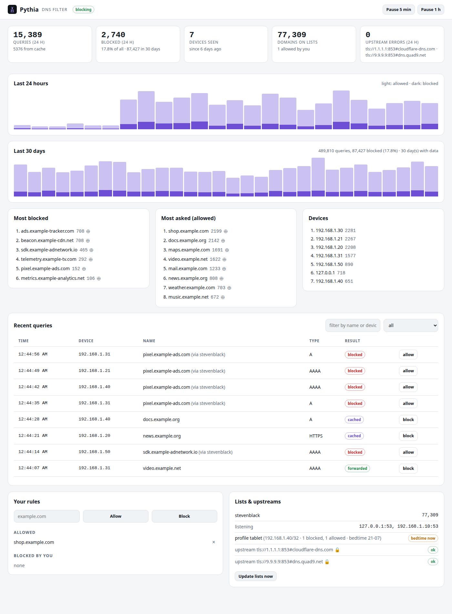
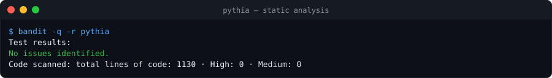
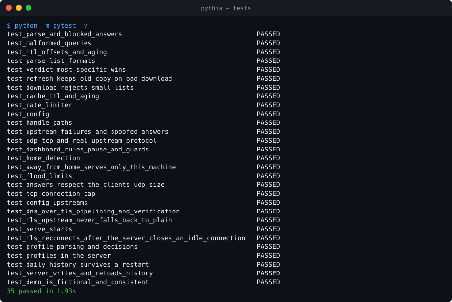

# Pythia

[](https://github.com/fas0ftware/pythia/actions/workflows/ci.yml)


A DNS filter for the whole home network. Phones, TVs and laptops ask Pythia for
addresses; names on ad, tracker and malware lists get `0.0.0.0`, everything else is
forwarded and cached. Nothing to install on the devices. Standard library only.

Named after the oracle of Delphi, who answered every question, but not always the way
the asker hoped.



```text
$ dig @192.168.1.10 github.com +short
140.82.121.3
$ dig @192.168.1.10 doubleclick.net +short
0.0.0.0
$ dig @192.168.1.10 doubleclick.net AAAA +short
::
```

## Contents

- [How it works](#how-it-works)
- [Install](#install)
- [Making the network use it](#making-the-network-use-it)
- [Dashboard](#dashboard)
- [Per-device profiles](#per-device-profiles)
- [Settings](#settings)
- [Security and privacy](#security-and-privacy)
- [Testing](#testing)
- [Limits](#limits)
- [Roadmap](#roadmap)

## How it works

For each query, over UDP or TCP:

1. **Who is asking?** Only addresses in `allow_networks` get an answer; anything else is
   dropped silently, so Pythia can never be used as an open resolver. On a laptop,
   `home_gateway_mac` limits network clients to the home network: in a café it serves
   only the laptop itself.
2. **Too fast?** A token bucket per device (100 queries/s, bursts of 200) drops floods; at most
   256 upstream queries run at once and 100 TCP connections (10 per device) stay open, so
   spoofed source addresses cannot exhaust memory or file descriptors either.
3. **Well formed?** One question, standard query, class IN. Malformed packets get
   `FORMERR`; `ANY` gets `REFUSED` (the classic amplification query).
4. **Blocked?** The name and each parent (`a.ads.example.com`, `ads.example.com`,
   `example.com`) are looked up. The most specific entry decides; at the same level your
   allow entry beats a block. Blocked `A` → `0.0.0.0`, `AAAA` → `::`, any other type →
   no data, so apps give up at once instead of timing out.
5. **Cached?** Answers are kept for their TTL (at most a day; `NXDOMAIN` 5 minutes) and
   handed out with the TTLs lowered by the time they waited.
6. **Forward** the client's own bytes with a fresh random id to the first working
   upstream, by default over **DNS over TLS** (RFC 7858, port 853): the certificate is
   checked against the name you give, one connection carries many queries at once, and
   a connection the server closed is reopened. A TLS upstream is never asked in plain
   text, not even when it is down. The answer must carry the right id and the same
   question, or it is thrown away: a spoofed or misrouted answer never reaches a device
   or the cache. An answer larger than the client's UDP size (512 bytes, or what its
   EDNS record says) goes back marked *truncated*, and the client asks again over TCP.

Lists are downloaded over HTTPS once a day. A download that does not look like a list
(an error page, fewer than 1000 names) keeps the previous copy; the new set replaces the
old one in a single step, so lookups never see half a list.

## Install

Linux with systemd. Port 53 needs one capability; the unit grants only that one.

```bash
git clone https://github.com/fas0ftware/pythia && cd pythia
contrib/install.sh                       # code to ~/.local/lib/pythia, settings to ~/.config/pythia
$EDITOR ~/.config/pythia/pythia.toml     # listen, allow_networks, home_gateway_mac
# then the sudo lines the script prints:
sudo install -m 644 ~/.local/state/pythia/pythia.service /etc/systemd/system/pythia.service
sudo systemctl daemon-reload && sudo systemctl enable --now pythia
sudo ufw allow from 192.168.1.0/24 to any port 53       # if ufw is on
```

Try it without installing (port 5354, this machine only):

```bash
printf 'listen = ["127.0.0.1:5354"]\n' > /tmp/p.toml
python -m pythia --config /tmp/p.toml update-lists
python -m pythia --config /tmp/p.toml serve &
dig @127.0.0.1 -p 5354 doubleclick.net +short
python -m pythia --config /tmp/p.toml check ads.example.com
```

## Making the network use it

In the router's DHCP settings:

1. **Reserve** the Pythia machine's address (so it keeps e.g. `192.168.1.10`).
2. **Primary DNS** = that address. **Secondary DNS** = a public resolver
   (`1.1.1.1`): when the Pythia machine is off, the network keeps working.

Devices pick up the change when they reconnect. The price of the secondary server: some
devices sometimes ask it directly, and then an ad gets through. The alternative, Pythia
alone, means no internet at home whenever that machine is off.

## Dashboard

`http://127.0.0.1:8748` on the Pythia machine (never on the network: it shows who asked
for what). Queries and blocks per hour for the last 24 hours and per day for the last 30, most blocked and most asked names, devices,
recent queries with one-click *allow* / *block*, your own rules, list sizes, upstream
health, and *pause 5 min / 1 h* for when a site breaks. `GET /api/summary` gives the
counts as JSON, and the same summary is written to `~/.local/state/pythia/status.json`
every 30 seconds for dashboards such as [Olympos](https://github.com/fas0ftware/olympos).

The hourly and daily counts are kept in `history.json` next to the status file (31 days,
counts only), so the charts survive a restart.

To see the dashboard without running a DNS server, `python -m pythia demo` serves it on
`http://127.0.0.1:8749` with made-up devices and names (the screenshot above).

## Per-device profiles

Stricter rules for chosen devices, a child's tablet for example. Give those devices fixed
addresses in the router, then:

```toml
[[profiles]]
name = "Kids tablet"
clients = ["192.168.1.50"]                 # addresses or networks
block = ["youtube.com", "tiktok.com"]      # on top of the house lists
allow = ["edu.youtube.com", "khanacademy.org"]
bedtime = "21-07"                          # local hours: everything else is blocked then
```

A profile is checked before the house lists, so a name allowed for the house can still be
blocked on the tablet. The most specific entry wins (`edu.youtube.com` stays open while
`youtube.com` is blocked); during bedtime only the profile's `allow` names answer. *Pause*
on the dashboard lifts profiles too. The dashboard lists the profiles and says when
bedtime is on, and blocked queries name the rule (`profile Kids tablet: bedtime`).

## Settings

`~/.config/pythia/pythia.toml` (template: [`pythia.example.toml`](pythia.example.toml)):

| Setting | Default | Meaning |
|---|---|---|
| `listen` | `["127.0.0.1:53"]` | addresses to answer on; a LAN address is bound even before Wi-Fi is up (`IP_FREEBIND`) |
| `allow_networks` | loopback | who may ask; `0.0.0.0/0` is refused |
| `home_gateway_mac` | none | answer network clients only behind this router |
| `upstreams` | `tls://1.1.1.1#cloudflare-dns.com`, `tls://9.9.9.9#dns.quad9.net` | tried in turn; `tls://IP[:port]#name` = DNS over TLS checked against `name`, a bare `IP[:port]` = plain DNS |
| `[[lists]]` | StevenBlack hosts | `name` + `https://` URL; hosts files, domain lists and simple `\|\|name^` rules |
| `list_refresh_hours` | 24 | |
| `blocked_ttl` | 300 | how long devices remember "blocked" |
| `rate_limit` | 100 | queries per second per device |
| `log_queries` | true | keep the last 300 queries in memory for the dashboard |
| `web_port` | 8748 | dashboard, 127.0.0.1 only |

Your allow and block entries live in `~/.local/share/pythia/custom.json`.

## Security and privacy

- **Not an open resolver:** unknown sources get no answer at all, `ANY` is refused, and a
  per-device rate limit stops floods. `allow_networks` cannot be the whole internet.
- **Spoofed answers:** fresh random query id and source port per forwarded query; the
  answer's id and question must match, else `SERVFAIL` and nothing is cached.
- **Untrusted input:** every packet is bounds-checked (label lengths, compression
  pointer loops, 253-byte names, record lengths); list downloads are size-capped and
  sanity-checked.
- **Least privilege:** runs as your user with only `CAP_NET_BIND_SERVICE`, a read-only
  system and home except its own two directories, no devices.
- **Privacy:** which device asked for which name stays in memory and on the 127.0.0.1
  dashboard; it can be turned off (`log_queries = false`). The status and history
  files have counts only. With the default DNS over TLS your provider sees only that you use encrypted DNS;
  the upstream (Cloudflare, Quad9) still sees the names that are not blocked.
- Dashboard: Host/Origin checks, JSON-only POSTs, strict CSP, values inserted as text.



## Testing

```bash
pip install -r requirements-dev.txt
python -m pytest -q
```



The tests cover the wire format (blocked answers, malformed packets including
compression loops), TTL aging, list formats and the most-specific-wins rule, keeping
the old list when a download is bad, the cache, the rate limiter, the open-resolver
guard, IPv4-mapped clients, `ANY`, pause, upstream failure and spoofed answers, the
home-network check, the dashboard's rules and guards, and a real UDP and TCP round
trip through Pythia to a fake upstream on loopback. CI also starts the server and asks
a real upstream through it.

Checked by hand on the author's laptop: 77 309 domains from the StevenBlack list;
blocked `A`, `AAAA` and `HTTPS`; cached answers in 0 ms; TCP; a large `TXT` answer
truncated over UDP and retried over TCP by `dig`; `NXDOMAIN` and `ANY`.

## Limits

- One machine; no failover between two Pythias.
- No DNSSEC validation of its own (it passes the bits through; the upstreams validate).
- Devices with their own encrypted DNS (some browsers' DNS over HTTPS, Android "private
  DNS") skip any network DNS filter, Pythia included.

## Roadmap

- ~~Encrypted upstream (DNS over TLS) so the provider cannot read the names.~~ Done in 0.2.
- ~~Per-device rules (stricter for a child's tablet) and schedules.~~ Done in 0.3 (profiles with a bedtime).
- ~~History on disk: blocked per day for a month.~~ Done in 0.4 (and `pythia demo`).
- Recent queries per device: pick a device and see only its queries.

## License

MIT
